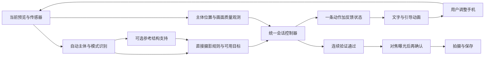

# GenWow AI 摄影引导：完整指令与动画制作交接

版本：1.2｜更新日期：2026-10-17｜代码基准：本轮 `codex/scene-guidance-v2`

适用人员：引导动画设计、UI 设计、Android 接入、AI 引擎及测试。

本文覆盖拍摄页的 AI 分析、单步调整、执行反馈、就绪和拍摄结果提示。**「当前实现」对应本轮代码；「制作要求」是设计及接入规范；「预留」表示有接口或代码，但当前不能作为已上线能力。本文随运行代码同步维护，尚未产出独立动画素材。**

阅读顺序：设计人员先看第 1～7、10、11 节；Android 人员同时看第 8、9、12、13 节。既有文档中与本快照冲突的旧状态机、固定帧数和动画参数，不作为本次交接依据。

## 1. 引导到底在表达什么

当前端侧小模型主要提供场景、参考检索和检测结果；自动模式、摄影规则目标、画面质量检查及 `CompositionSessionController` 共同形成最终指令。规则可直接保持构图或改善已观测主体边距，不必先匹配一张模板。**当前不是大语言模型自由生成一段摄影建议，也不是直接生成动画文件。**

完整链路：



给用户表达的核心是：**现在做什么 → 是否更接近目标 → 是否需要停下 → 是否可以拍摄。** 同一时刻只突出一条动作。

以下含义必须分开：

| 信号 | 正确含义 | 不应表达为 |
|---|---|---|
| 参考图匹配 | 当前场景有可参考的构图 | 模仿后一定更美 |
| `IMPROVING` | 可比较观测中的几何误差下降 | 美感提升、审美评分上升 |
| `VERIFYING` | 位置基本合适，继续确认稳定性 | 已完成、即将拍照 |
| `READY` | 本次可验证条件通过，可以进入拍摄准备 | 最佳照片、所有画面因素都完美 |
| `SAVED` | 照片保存成功 | 仍在等待快门 |
| `HoldStill` | 暂停动作或等待依据，具体看反馈 | 一律达标 |

当前审美评分头及相对取景偏好头均未通过准入并处于关闭状态。动画中不使用「美感 92 分」「更好看 30%」「最佳构图」等表达。人像检测主要是人脸框，不能表现成已识别完整人体轮廓、头发边界或摆姿。

## 2. 不同场景的引导范围

| 场景 | 当前可用依据与引导 | 动画需要表达的边界 |
|---|---|---|
| 单人、脸清晰可见 | 根据人脸边距直接保持或小幅取景，可选参考结构支持、端平及画质反馈 | 框标识已观测人脸；不画不存在的人体姿势骨架 |
| 食物、静物 | 稳定受支持对象可直接生成规则目标；兼容参考为可选支持 | 有合格对象目标才引导移动；有检测框不等于有合格目标 |
| 植物 | 场景及参考推荐、适用的可测质量信息 | 当前不能承诺通用花朵或枝叶轮廓对齐 |
| 自然风景、城市风景 | 参考布局兼容性、可观测的设备水平、质量信息 | 没有可靠语义地平线与天空分割；不画“AI 检出的地平线” |
| 多人、主体丢失、未知场景 | 保持、重新确认、允许手动拍摄 | 不随机追踪另一张脸，不强制给出方向 |
| 俯拍食物等姿态 | 仅在姿态可观测、规则适用时判断水平 | 不把俯拍误画成必须抬起手机；不要求所有照片俯仰归零 |

摄影规则可独立提供有依据的目标。健康构图保持首次接受的位置；明确贴边才考虑有限调整，健康轴保持不动，不把所有照片推向中心或三分点。规则保护已观测主体边距，执行后检查清晰度和亮部细节。三分线仅作静态参考。背景细节增加在食物、静物中仅是软证据；不能因此把树林、建筑等丰富纹理一概判为失败。

**当前接线：**人脸及对象均通过控制器 `GuidanceDecision.displayEvidence` 提供主体、目标和有效期限。`GuidancePresentation` 统一驱动双点、提示和成功反馈；过期或状态不一致时隐藏旧标记并暂停。

### 2.1 自动模式与无模板目标

拍摄页不要求用户选择人像、静物或风景。检测到有效人脸优先人像；没有有效脸框时，合格人物检测也可确认人像模式，其次稳定受支持物体，再考虑通过共识门槛的语义场景。新模式需独立采样稳定确认。多人或只有人物框时可判为人像，但不能因此自行选人、把人物框当脸框或发摆姿指令。模式未确定时用静态确认状态，不让动画沿用旧模式的目标。

模式标签只说明分析策略，不代表自动虚化、变焦或摆姿功能。无参考图时也可出现规则目标；不要强制播放“匹配模板完成”作为移动动画的前置步骤。参考仍可用于浏览和兼容性支持。具体门槛与范围见 [自动场景与无模板摄影引导](./自动场景与无模板摄影引导-2026-10-17.md)。

## 3. 完整动作清单：13 个 `GuidanceAction`

“当前文案”用于了解现状；**“制作采用文案”是本次推荐的简短主指令，尚未替换代码中的字符串。** 原因说明另放副行，不与另一条动作拼在一起。箭头及手机图标表达手机动作，主体到目标的连接线表达画面位置差，二者不能混用。

| 动作 / cue | 当前文案或表现 | 制作采用文案 | 动画语义 | 当前状态 |
|---|---|---|---|---|
| `HoldStill` / `NONE` | 按反馈显示保持、等待或通用提示 | 先保持 | 停止方向循环，静态标记；副行说明原因 | 可用 |
| `RotateClockwise` / `ROLL_CLOCKWISE` | 顺时针旋转手机，让粉线贴合白色虚线 | 手机稍顺时针转 | 面向手机屏幕，平面内顺时针端平 | 可用 |
| `RotateCounterClockwise` / `ROLL_COUNTERCLOCKWISE` | 逆时针旋转手机，让粉线贴合白色虚线 | 手机稍逆时针转 | 面向手机屏幕，平面内逆时针端平 | 可用 |
| `MoveLeft` / `MOVE_LEFT` | 手机稍向左移，让主体接近目标 | 手机稍向左移 | 手机向左；不要播放“主体向左”的演示 | 合格人脸／对象目标可用 |
| `MoveRight` / `MOVE_RIGHT` | 手机稍向右移，让主体接近目标 | 手机稍向右移 | 手机向右；主体点以真实观测更新 | 同上 |
| `MoveUp` / `MOVE_UP` | 手机稍向上移，让主体接近目标 | 手机稍向上移 | 手机向上，小幅调整取景 | 同上 |
| `MoveDown` / `MOVE_DOWN` | 手机稍向下移，让主体接近目标 | 手机稍向下移 | 手机向下，小幅调整取景 | 同上 |
| `PitchUp` / `PITCH_UP` | 调整俯仰；抬高手机镜头 | 镜头稍向上仰 | 侧视手机绕横轴上仰，区别于竖直平移 | **预留，不启用** |
| `PitchDown` / `PITCH_DOWN` | 调整俯仰；降低手机镜头 | 镜头稍向下俯 | 侧视手机绕横轴下俯 | **预留，不启用** |
| `YawLeft` / `YAW_LEFT` | 调整方向；向左转动手机 | 手机稍向左转 | 俯视手机绕竖轴左转，区别于平面内端平 | **预留，不启用** |
| `YawRight` / `YAW_RIGHT` | 调整方向；向右转动手机 | 手机稍向右转 | 俯视手机绕竖轴右转 | **预留，不启用** |
| `DeviceUpsideDown` / `DEVICE_UPSIDE_DOWN` | 请翻转手机后继续拍摄 | 请把手机转正 | 180°转正示意，与左右小幅端平区别 | 分支及素材存在，触发逻辑待统一 |
| `Ready` / `SUBJECT_ALIGNED` | 保持不动 · 即将拍摄 | 保持不动，即将拍摄 | 绿色静态确认或低幅呼吸；撤销时立即退出 | 控制器验证通过后可用 |

### 3.1 动作何时改变或结束

- 端平：当前 roll > +4°时指示逆时针；roll < −4°时指示顺时针。进入容差只是端平条件之一，后续还需要稳定观测。
- 移动：按校正画幅后的主导误差选一个轴。同一目标内以最新观测判断接近、进入容差或恶化；动画不根据自己画出的像素距离另选方向。
- 保持：由反馈区分验证、依据不足、恶化、无改善、画面变化。暂停不是固定播放两秒后自动恢复。
- Ready：只接受控制器状态；主体、质量、传感器证据失效时可撤销。不能由绿色、目标圆重合或动画播放结束自行触发。
- Pitch/Yaw：必须有已验证的目标姿态。当前生产链路没有这类目标生成者，即使能读取传感器角度，也不能启用这四个动作。
- 倒置：当前真实 180°倒置可能先进入 roll 调整分支。可准备素材，但需修正逻辑并验证后，才能作为稳定可用功能验收。

### 3.2 额外 cue 与 phase，不是额外用户动作

`GuidanceCue` 共 14 项：上表映射涵盖 13 项，另有 `SUBJECT_TARGET`。它属于底层几何／旧显示契约，表示主体目标提示；当前控制器没有同名动作。缺少有效主体主要通过 `HoldStill` 和反馈表达。

`GuidancePhase` 为 `NEUTRAL`、`ADJUST`、`NEAR`、`WRONG_DIRECTION`、`ALIGNED`。它是视觉阶段，不是最终拍摄权限。当前拍摄工作流未生成 `WRONG_DIRECTION`，执行恶化实际使用 `WORSENING + HoldStill`。

### 3.3 当前没有的动作，不纳入本轮动画接入

当前动作协议没有“前进／后退若干厘米”“自动变焦到某焦段”“请人物转脸／摆姿”“向某方向补光”“移除背景杂物”等指令，也不能根据一张候选裁剪预测移动后尚未出现的背景或透视。不要为这些能力制作看似已生效的引导入口。

如以后新增动作，应先定义可观测条件、实际执行反馈和停止规则，再扩展动作枚举与动画。暂时缺少依据时使用保持，不让动画自行补出建议。

## 4. 完整反馈、原因与文案

### 4.1 八种执行反馈

| `GuidanceFeedback` | 当前屏幕文案 | 制作要求 |
|---|---|---|
| `INSUFFICIENT_EVIDENCE` | 先保持，正在确认可用的构图依据 | 停止方向演示；弱呼吸或静态等待，不变绿 |
| `ADJUSTING` | 使用当前动作文案 | 只循环当前动作；保留真实目标标记 |
| `IMPROVING` | 当前没有独立覆盖文案 | 可选副行“正在接近目标”；不改成审美成功提示 |
| `VERIFYING` | 位置合适，请保持稳定 | 停止移动演示，使用等待样式；不播放 Ready 或保存勾 |
| `READY` | 保持不动 · 即将拍摄 | 绿色确认，只在最终 `Ready` 状态使用 |
| `WORSENING` | 按下表选择原因文案 | 立即停止动作；建议用橙色静态提示，不直接发相反指令 |
| `NO_PROGRESS` | 先保持，暂未找到更有效的调整 | 停止催促，等待引擎重规划结果；不无限转圈 |
| `SCENE_CHANGED` | 画面发生变化，先保持重新确认 | 隐去失效方向，等待新依据；不得计为用户执行成功 |

`WORSENING` 当前文案优先级：

1. `observed_subject_margin_regressed` → “先保持，主体太靠近画面边缘”。
2. `subject_sharpness_regressed` → “先保持，主体清晰度下降”。
3. `subject_highlights_regressed` → “先保持，主体亮部细节减少”。
4. 其他 → “先保持，刚才的调整没有改善构图”。

不将所有恶化都写成“方向错了”。主体可能自己移动、相机可能正在调整曝光，质量下降也不一定能通过反方向移动恢复。

### 4.2 原因码全集

| `reasons` 值 | 含义 | 动画处理 |
|---|---|---|
| `comparison_context_changed` | 场景、主体身份、尺度、坐标或采样间隔导致不可比较 | 保持／重新确认 |
| `photometric_context_changed` | 曝光或亮度分布发生显著变化 | 等待确认；不要指示补光方向 |
| `subject_motion_not_attributed_to_camera` | 主体位移不能可靠归因于手机动作 | 不发成功反馈；保持确认 |
| `subject_sharpness_regressed` | 已观测主体清晰度明显下降 | 保持，显示清晰度原因 |
| `subject_highlights_regressed` | 已观测主体亮部细节明显减少 | 保持，显示亮部原因 |
| `observed_subject_margin_regressed` | 已观测主体变得太靠近边缘 | 保持，提示边距风险 |
| `background_detail_increased_soft` | 食物／静物背景细节增多的软证据 | 不单独触发失败或停止动画 |
| `validated_preference_regressed` | 已准入偏好模型给出下降 | 当前模型关闭，保留协议，不展示此能力 |
| `rule_execution_paused` | 本次规则目标执行尚未得到有效验证，暂停继续规划 | “先保持，刚才的调整尚未得到有效验证” |
| `subject_margin_requires_unverified_scale_change` | 小幅平移无法满足已观测主体的保护要求 | “先保持，当前主体范围不适合小幅取景调整”；不自行播放缩放动画 |
| `no_verified_portrait_target` | 人像场景没有有效参考或直接规则目标 | “先保持，正在确认人像的可用构图依据” |
| `relieve_measured_subject_edge_pressure` | 当前目标在改善可测边距 | 仍显示控制器选中的一个方向；不显示美感提升比例 |
| `no_measured_subject_edge_defect` | 未发现本规则定义的主体贴边问题 | 保持原有位置；等待控制器验证，不等于审美最优 |

原因列表可为空，也不保证下一条决策继续携带上一条原因。UI 使用当前决策和稳定的文案映射；不要把上一张脸、上一目标的原因留在新目标上。

### 4.3 场景与异常辅助文案（制作要求）

| 条件 | 建议文案 | 出现依据 |
|---|---|---|
| 已选单人主体丢失 | 请让主体回到画面内 | 已有目标且主体确实丢失 |
| 多人目标不明确 | 暂未确定拍摄主体，请先保持 | 引擎／适配层明确识别该原因 |
| 暂无可靠目标 | 暂未找到可靠的构图建议 | 依据不足；不能冒充“没有人脸” |
| 镜头或画幅切换 | 正在重新确认画面 | `viewportVersion` 或会话上下文改变 |
| 引擎不可用 | 暂时无法分析，可直接拍摄 | 引擎失败状态；不得播放模拟成功 |
| 拍摄失败 | 拍摄未完成，请重试 | 实际拍摄错误回调 |

当前已接入规则执行暂停、主体范围不适合小幅调整、单人依据不足、对象不稳定、风景目标不可验证及植物完整范围不确定等原因码。旧参考不兼容原因仍可出现，但“没有模板”本身不再等于不能引导。其他细分提示仍需对应证据，不能仅凭通用 `INSUFFICIENT_EVIDENCE` 猜测。证据无法细分时沿用通用保持提示。

## 5. 状态流程与中断要求

### 5.1 控制器状态与当前 UI 映射

| 控制器 `State` | 当前 `CaptureWorkflowState` | 用户看到什么／制作要求 |
|---|---|---|
| `Idle` | `IDLE` | 正常预览，无主动调整提示 |
| `Analyzing` | `ANALYZING` | 正在分析构图；请保持画面稳定 |
| `Adjusting` + 旋转 | `ROTATING` | 当前一条端平／姿态指令 |
| `Adjusting` + 移动或一般保持 | `GUIDING` | 当前动作，或有原因的保持 |
| `Adjusting` + 证据不足 | `GUIDING` 暂停样式 | 根据原因码显示静态保持提示；`NO_SUBJECT` 组件为兼容保留，不作为当前主链路判据 |
| `Adjusting` + 倒置 | `UPSIDE_DOWN` | 转正提示，待触发逻辑统一 |
| `Verifying` | `GUIDING` | 位置合适，请保持稳定；使用独立验证视觉 |
| `Ready` | `READY` | 保持不动，即将拍摄 |
| `Capturing` | `CAPTURING` | 正在拍摄；请保持手机稳定，正在处理照片 |
| `Saved` | `SAVED` | 照片已保存；此时才能显示保存成功勾 |
| `Error` | `IDLE`，另做错误处理 | 停止引导，呈现实际错误与重试入口 |

当前顶部状态条还有“第 1 步：调整手机姿态”“第 2 步：移动主体到目标”。新设计推荐改为“调整手机姿态”“微调取景”，避免让用户误以为要指挥人物走动，也避免必须经过每一步的错觉。

### 5.2 Ready 的真实准入

有可验证目标、必要观测有效，并满足已有水平和位置稳定条件后，还需要 **至少 3 个独立、新鲜的达标观测，时间跨度不少于 750ms**。这是达标观测的跨度，不是从开始分析起等 750ms，也不是动画转三圈。

目标可以来自摄影规则，不要求必有模板。Ready 表示本次可测技术条件通过；保持构图通过验证也可 Ready，不能展示为“AI 已选出最美画面”。仅端平、模式识别成功、规则建议出现都不能单独触发 Ready。

| 证据 | 当前时效要求 |
|---|---|
| 人脸观测 | 不超过 750ms |
| 物体观测 | 不超过 1500ms，另需置信度及稳定性条件 |
| IMU | 不超过 1500ms |
| 执行画面质量 | 不超过 1500ms |
| 自动拍摄前最后一次有效 Ready 观测 | 不超过 750ms，并重新检查其他证据 |

水平稳定还有自己的连续观测条件；位置稳定也有独立条件。动画不得复制这些阈值另建一套完成判断。缓存、重复帧、乱序帧不能增加完成次数。新鲜坏证据可以撤销 Ready，即使其他传感器仍是缓存。

自动拍摄流程是 `Ready → AF/AE 准备 → confirmReadyForCapture → Capturing`。对焦曝光等待期间依据失效，退回保持，取消本次自动拍摄。动画不得为了播完庆祝效果延迟撤销。

### 5.3 执行反馈与暂停

- 几何误差连续两次有效观测恶化，暂停当前目标。
- 已观测主体清晰度、亮部细节或边距明显退化，可立即触发保持，不必等两次几何恶化。
- 有动作但五秒没有有效改善，暂停；引擎最多自动请求一次重新规划。动画层不发起额外重规划。
- 曝光变化、主体自行移动等不可比较情况，先重新确认，不当成成功执行。
- 目标执行期间保持目标稳定。目标失效、主体切换、镜头切换或坐标版本变化，旧方向与旧目标标记一起失效。

### 5.4 动画中断与优先级（制作要求）

优先顺序：取消／错误／拍摄结果状态 → 证据失效或暂停 → 验证／Ready → 当前动作 → 装饰性波纹。

1. 收到暂停或失效，立即停止带方向的循环；允许短暂透明度退出，但不再继续演示移动。
2. 同一动作持续更新时保持循环相位，不因每次推理结果重新播放入场。
3. 动作改变时取消旧循环，再显示新方向；不能让左右两种箭头交叉播放。
4. 同一目标的显示位置可平滑插值；目标 ID 或坐标版本改变时直接清除旧锚点，不跨目标滑行。
5. `VERIFYING` 使用静态点或轻微呼吸，不用定时自动填满的倒计时圈。
6. Ready 的短确认效果每次有效进入只触发一次；撤销后取消。保存成功勾只由 `Saved` 触发。
7. 退出相机页、App 进入后台或会话取消，停止全部引导动画与播报。

当前按快门开始分析，引导过程中再按快门可按当前画面直接拍摄。这是用户手动拍摄路径，不能伪造一次 Ready 成功动画。现有分析阶段的 800ms 等待也不是“AI 一定已分析完”的证明。

## 6. 动画分镜与制作清单

### 6.1 核心动画族

| 资产／组件 ID | 分镜和运动要求 | 循环与结束 | 优先级 |
|---|---|---|---|
| `guide_analyzing` | 轻量波纹＋分析文案，画面仍可见 | 分析期间循环；状态退出即停 | P0 |
| `guide_move_left/right/up/down` | 简洁手机示意沿单一方向小幅运动；对应箭头清晰 | 只向指令方向演示；复位时淡出，不把反向复位画成第二条指令 | P0 |
| `guide_roll_cw/ccw` | 白色基准线＋随真实 roll 更新的活动线；可配平面旋转手机示意 | 真实水平变化驱动主线；装饰示意可循环，不自行归零 | P0 |
| `guide_target_tracking` | 当前主体点、目标点、连接线及真实框 | 几何位置由观测驱动；不能预录点位自动靠拢 | P0，动态组件 |
| `guide_hold` | 停止方向演示，保留可用静态标记和原因 | 保持至新决策；不自动完成 | P0 |
| `guide_verifying` | 位置已合适的静态提示＋低幅呼吸 | 等待控制器；不显示保存勾或自动倒数 | P0 |
| `guide_paused` | 静态暂停标记＋恶化／无改善原因 | 不催促反向调整，不无限分析旋转 | P0 |
| `guide_rechecking` | 画面变化或证据暂缺的轻量等待 | 等新证据；旧方向隐藏 | P0 |
| `guide_subject_missing` | 隐去失效框，用通用主体提示 | 有真实主体后才恢复锚点 | P0 |
| `guide_ready` | 绿色确认，文字“保持不动，即将拍摄” | 短入场＋静态／轻呼吸；可随时撤销 | P0 |
| `guide_capturing` | 非方向性拍摄处理中提示 | 等实际拍摄结果 | P0 |
| `guide_saved` | 一次成功勾或保存确认，然后静态 | 等结果页／会话结束，不持续庆祝循环 | P0 |
| `guide_error` | 静态失败提示，重试由普通 UI 承载 | 用户重试或退出 | P0 |
| `guide_pitch_up/down` | 侧视手机俯仰，明确旋转轴 | 仅素材预留，不挂到当前真实引导 | P1 |
| `guide_yaw_left/right` | 俯视手机偏航，与 roll 区别 | 同上 | P1 |
| `guide_upside_down` | 手机从倒置转正的 180°示意 | 触发逻辑修正后接入 | P1 |

斜向偏差只显示当前选中的一个轴。目标点可以在斜向位置，但不能因此同时播放“向右＋向上”两个动作。每种方向必须有静止关键帧，供暂停及减少动态效果模式使用。

### 6.2 主体与目标的画法

- 当前主体：实心点或角标，跟随有效观测。人脸框只包围检测到的人脸区域。
- 构图目标：空心圈或明确不同形状。目标有 ID，保持到引擎撤销或替换。
- 主体—目标连接：表现距离关系；当前实现是虚线，没有箭头头部。若新增流动效果，必须明确是画面位置差，不能冒充手机移动箭头。
- 端平线：设备姿态参考，名称使用“水平参考线”。未经语义检测，不沿山脊、海岸或建筑边缘假装识别地平线。
- 无真实位置或目标时不画虚构框，不把画面中心冒充检测到的主体。
- 验证前不填充成功勾。绿色局部“已接近”与全流程 Ready 容易混淆，本次制作统一将明确成功色保留给最终 Ready／Saved。
- 引导覆盖层用于实时预览，不写入用户拍摄的照片文件。动画不拦截预览对焦、快门或取消操作；需要点击的控件由普通 UI 单独承载。

## 7. 视觉参数、动效节奏与布局

### 7.1 当前实际参数，供衔接现有视觉

当前挂载的是 `CaptureWorkflowOverlay`。以下来自该组件及主题代码，不是旧动画组件的参数。

| 项目 | 当前数值 |
|---|---|
| 普通引导色 | `#F4B6C2`，`BrandPink` |
| 已对齐色 | `#8CE0C3`，`GuideAligned` |
| 波纹紫色 | `#4B3A62`，`BrandPurple` |
| 警告色 | `#FF9D55` 已定义；当前暂停尚未统一切换橙色 |
| 分析波纹 | 2000ms 循环，三层相位 0 / 0.33 / 0.66；中心 `(0.5W, 0.68H)` |
| 分析入场／退场 | 400ms / 300ms |
| 引导、端平、Ready、丢失主体入场／退场 | 300ms / 200ms |
| 双点呼吸 | 900ms 单程、反向重复，完整周期 1800ms；透明度 0.55～1 |
| 主体点／目标点 | 基准半径 6dp / 7dp |
| 连线 | 未对齐 2.5dp 虚线，节奏 18dp / 12dp；对齐 3dp 实线 |
| 主体框／目标圈 | 2dp 描边；主体框圆角 10dp；目标圈半径按视口短边计算 |
| 三分网格 | 全视口 1/3、2/3 位置，1dp，白色透明度约 0.34 × 设置透明度 |
| 端平卡 | 300 × 146dp，黑底透明度 0.82，圆角 26dp |
| 端平卡内线 | 白虚线 3dp，活动线 4dp；显示角限制 ±20°，对齐阈值 4° |
| 全视口端平线 | 白虚线 2dp，活动线 3dp；与端平卡分开绘制 |
| Ready 呼吸 | 800ms 单程、反向重复，完整周期 1600ms |
| 拍摄／保存呼吸 | 520ms 单程、反向重复；保存时才绘制勾 |
| 顶部步骤条 | 顶部偏移 108dp，220 × 22dp，说明文字 11sp |
| 全屏绿边闪 | 160ms 到透明度 0.55，再 390ms 退至 0；当前触发源需修正 |

已移除 Ready 的固定 0.18 装饰圈。实际目标范围读取控制器 `displayEvidence.targetRadius`，再映射到 `target_zone.radius`；双点的 6/7dp 小圆不是允许误差。

### 7.2 本次制作要求

- 沿用以上配色和基础线宽；用形状及文字补充状态，不能只靠粉／绿／橙区分。
- 默认保留现有 300ms / 200ms 入退场节奏；暂停时先停止方向运动，再完成退场。
- 手机示意的建议循环为 1200～1600ms，近目标时降低幅度；这是新设计建议，并非现有工作流已接入的参数。
- 主指令建议 15～17sp，辅助说明 12～14sp；文字由 App 渲染，支持换行及系统字体缩放，不烘焙到动画中。
- 文案区域使用半透明深色底或其他可读性处理，在天空、白墙、夜景、复杂纹理上分别检查。
- 主体锚点放在真实预览坐标；提示卡、按钮及说明使用安全区域布局。不得为了避开底栏而把目标点挪离真实位置，可减少装饰或调整文字位置。
- 390 宽网页仅作视觉参考，不能作为 Android 固定像素画布。验收至少覆盖 360／390／430dp 宽及不同预览画幅；不假设横屏只需把整张海报旋转。
- 提供减少动态效果的静态版本，取消大范围波纹与反复缩放。当前尚未接入专用开关，需 Android 落地。
- 状态文案进入无障碍语义树；读屏只在动作／反馈实质改变时播报，不按帧反复播报。触觉建议只用于最终 Ready 的有效进入，并允许关闭；当前接线需修正。
- 动画使用 UI 时钟，推理使用采样时钟，二者分离。暂停、后台及不可见时停止无意义循环；性能目标需在设备验证，不能以素材导出帧率承诺真机帧率。

## 8. 坐标、镜像与方向合同

### 8.1 唯一坐标空间

当前预览为 `FILL_CENTER`，Preview、Capture、Analysis 共用 `ViewPort`。推理及检测结果经过视口裁剪、转正及前摄镜像，传给当前绘制层的是**显示坐标**。

```text
左上角 (0,0) ───────────────→ x 向右
      │
      │       主体点 (sx,sy)
      │       目标点 (tx,ty)
      ↓
    y 向下                  右下角 (1,1)

像素点 = (previewLeft + x × previewWidth,
          previewTop  + y × previewHeight)
目标圈像素半径 = radius × min(previewWidth, previewHeight)
```

当前叠加层与预览同大小，局部原点相同；如果以后增加黑边或改为非全屏预览，Android 必须显式传入实际预览矩形。不能使用包含底栏／黑边的任意容器大小重新计算检测位置。

- `x/y/width/height/center_x/center_y` 是 0～1 归一化值。
- `angle_degrees` 是带正负号的角度，不属于 0～1。
- `radius` 按短边归一化；非正方形画幅下，不可同时当作 x、y 方向相同的归一化半径。
- 渲染层不能再因为 `isFrontCamera=true` 镜像一次，也不能再次应用传感器旋转。当前下发 `rotationDegrees=0`，表示已完成转正。
- 坐标版本不一致、坐标无效或目标为 null 时隐藏相关标记；不能用 `(0.5,0.5)` 补造一个目标。

### 8.2 手机方向与画面位移

下表是当前引擎的显示坐标合同。以静止主体、小幅调整的工作假设解释，不承诺预测实际三维位移或移动后的新背景。

| 主体相对目标的位置，且对应轴占主导 | 引擎动作 | 手机示意箭头 | 画面中期望的主体趋近方向 |
|---|---|---|---|
| 主体在目标右边 | `MoveRight` | 向右 | 向左靠近目标 |
| 主体在目标左边 | `MoveLeft` | 向左 | 向右靠近目标 |
| 主体在目标上方 | `MoveUp` | 向上 | 向下靠近目标 |
| 主体在目标下方 | `MoveDown` | 向下 | 向上靠近目标 |

例如当前主体 `(0.68, 0.42)`，目标 `(0.50, 0.42)`：手机动作是“稍向右移”，主体—目标连线则指向画面左侧。**不要把这条连线直接变成手机向左的箭头。**

动画只读取控制器 action，不能再次按前摄交换左右。前后摄方向已有几何模拟测试；真实设备上的握持、镜像和旋转表现仍需端到端验证，不能称为已全部通过真机验收。

## 9. Android 接口及接入样例

### 9.1 当前真实接口

当前是 Kotlin 进程内数据流，不是云端 HTTP 接口。

| 接口 | 关键字段 | 动画使用方式 |
|---|---|---|
| `CompositionSessionController.state` | `Idle/Analyzing/Adjusting/Verifying/Ready/Capturing/Saved/Error` | 最终工作流状态，Ready 和拍摄权限以此为准 |
| `GuidanceDecision` | `action,targetId,error,feedback,observationId,replanRequested,reasons` | 一条动作、执行反馈与原因 |
| `StructureObservation` | `observationId,sampledAtMs,viewportVersion,faceCount,face,faceYawDegrees,trackingId,valid,aspectRatio` | 人脸结构证据；不是通用人体关键点接口 |
| `ObjectObservation` | `observationId,sampledAtMs,viewportVersion,trackingId,classId,box,confidence,stableSamples,aspectRatio` | 对象观测；不能直接冒充人脸 |
| `CompositionTarget` | `id,center,tolerance,viewportVersion,source,preserveSubject,subjectTrackingId` 等 | 人像构图目标与保护约束 |
| `ObjectCompositionTarget` | `id,center,viewportVersion,trackingId,classId,referenceBox,tolerance,source` | 对象构图目标 |
| `ExecutionQualityEvidence` | 采样标识、时间、场景、主体及质量信息 | 供控制器比较；动画不另行评价审美 |
| `GuidanceState` | `cue,phase,progress,subjectOutline,anchors,stableFrameCount,unstableFrameCount` | 兼容／旧视觉契约；不能独立触发拍摄 |
| `RenderInput` | `sceneType,compositionStrategy,confidence,guideLines,isFrontCamera,rotationDegrees` | 几何绘制资料；`confidence` 不是美感概率 |

时间、主体和目标坐标统一使用 `GuidanceDecision.displayEvidence`；不要再从另一份渲染结果补造目标。采样时间使用 Android `elapsedRealtime` 单调时间，不是 Unix 时间；观测 ID 对应真实采样，不是动画帧编号。

目标 `source` 可为 `photography_rule_keep`（保留原构图）、`photography_rule_subject_margin`（改善已观测主体边距）或 `current_compatible`／`current_compatible_object`（参考与当前构图兼容）。来源用于说明依据，不直接决定动画方向或就绪。目标 ID 变化时清除旧连接线；KEEP 目标不能随主体逐帧移动。

`progress` 表示几何引导进度，`error` 表示误差；都不能显示为美感评分或作为 Ready 判据。`replanRequested` 供引擎处理，动画只显示等待反馈。

### 9.2 辅助线字段与当前渲染范围

| `GuideLineType` / JSON key | 参数 | 当前拍摄工作流 |
|---|---|---|
| `RULE_OF_THIRDS_GRID` / `rule_of_thirds_grid` | `vertical_lines,horizontal_lines` | 当前网格按设置直接画固定三分线，不读取自定义网格位置 |
| `THIRDS_POINTS` / `thirds_points` | 三分交点类型 | 已定义；当前工作流未单独消费 |
| `SUBJECT_BOX` / `subject_box` | `x,y,width,height,aligned`，另有 `real,anchor_kind` | 绘制真实框；`anchor_kind` 区分 `face/object` |
| `TARGET_ZONE` / `target_zone` | `center_x,center_y,radius`，另有 `anchor_kind` | 绘制目标圈 |
| `HORIZON_LEVEL` / `horizon_level` | `angle_degrees`，可选 `reference_y` | 当前取 roll 显示端平；不等于语义地平线 |
| `DIRECTION_ARROW` / `direction_arrow` | `from_x,from_y,to_x,to_y` | 模型定义存在；当前工作流未直接消费该线型 |
| `GUIDE_LINE_PATH` / `guide_line_path` | `points=[x0,y0,x1,y1,...]` | 同上；不据此宣称人体轮廓已接入 |
| `FRAMEWORK` / `framework` | 构图框架类型及点 | 当前工作流未直接消费 |
| `UNKNOWN` / `unknown` | 未知类型 | 忽略，不渲染伪造默认图形 |

当前主体框和目标圈遵守 `GuideLine.visible`；固定网格由 `showGrid` 控制，端平线由 `showHorizon`、工作流状态及 cue 控制，并不读取对应线型的 `visible`。后续新增线型也应遵守可见性约定。用户的网格、主体框、目标圈、水平线及透明度设置应继续生效；不能在动画素材中再烘焙一套无法关闭的辅助线。

### 9.3 建议的 UI 适配数据样例：尚未实现的包装格式

下面是为动画联调提出的 **`guidance-ui/1` 包装示例**，便于导出 fixture 或设计预览。它不是当前已有接口或实际采样记录；snake_case／camelCase 均按示例明确约定，不由素材方猜字段。若采用，应在 Android 单独实现适配器，并保留当前控制器作为唯一决策源。

```json
{
  "schemaVersion": "guidance-ui/1",
  "sessionId": "example-session-001",
  "sessionState": "Adjusting",
  "sceneFamily": "PORTRAIT",
  "decision": {
    "action": "MoveRight",
    "targetId": "example-target-001",
    "error": 0.18,
    "feedback": "ADJUSTING",
    "observationId": 81,
    "replanRequested": false,
    "reasons": []
  },
  "viewport": {
    "version": 7,
    "coordinateSpace": "display_normalized",
    "rotationAlreadyApplied": true,
    "mirrorAlreadyApplied": true,
    "widthPx": 1080,
    "heightPx": 1920
  },
  "evidence": {
    "sampledAtMs": 120000,
    "nowMs": 120100,
    "anchorKind": "FACE",
    "subjectTrackingId": 17
  },
  "geometry": {
    "subjectCenter": {"x": 0.68, "y": 0.42},
    "targetCenter": {"x": 0.50, "y": 0.42},
    "targetRadius": 0.08
  },
  "presentation": {
    "assetId": "guide_move_right",
    "messageKey": "guidance.move_right",
    "secondaryMessageKey": null,
    "reduceMotion": false
  }
}
```

包装中的 `mirrorAlreadyApplied=true` 表示前摄需要的镜像处理已经完成，素材不再镜像；不是要求后摄也镜像。示例视口与位置仅供联调，不能写死在素材里。

适配器处理要求：

1. 通过 `GuidancePresentation.from(sessionState, decision, elapsedRealtime)` 选组件；`Verifying` 的显示 cue 为 `NONE`，仅有效 Ready 才显示成功。
2. 同一快照中的目标 ID、追踪 ID、视口版本一致，才合并为一次有效呈现；没有位置用 null，不补中心点。
3. 暂停反馈优先于方向动画，`HoldStill` 不沿用上一条移动指令。
4. 未知枚举或无法解析的数据，停止方向提示并退回通用保持；不默认 Ready。
5. 动画回调仅处理可见性和播放状态，不调用 `startCapture()`、不增加稳定帧计数、不触发重规划。

## 10. 素材格式、目录和命名

### 10.1 默认交付方式

**默认采用参数化矢量设计＋Android Compose Canvas 实现。** 真实点位、框、目标圈、端平角度由运行时绘制。设计方交付形状、关键帧、节奏和说明即可，不需要制作一段包含固定脸框位置的整屏视频。

当前未引入 Lottie 或 Rive SDK。SVG 是可编辑交付源，不表示 App 已支持运行时直接加载 SVG；Android 可转成 VectorDrawable 或按路径用 Canvas 实现。

| 文件 | 是否需要 | 格式要求及用途 |
|---|---|---|
| 本地可编辑源文件 | 必需 | `.fig`／`.ai` 等实际使用的软件源文件，分层命名；外部在线链接仅作补充 |
| 矢量图标及静止帧 | 必需 | `.svg`，明确 `viewBox`，透明背景，去掉无用隐藏层；不包含实际指令文字 |
| 参数与状态表 | 必需 | UTF-8 `.json`；时长统一 ms，记录循环、入退场、关键帧、静止帧和方向语义 |
| 分镜说明 | 必需 | `.md`，列触发、暂停、取消、目标替换和减少动态效果表现 |
| 演示视频 | 必需 | `.mp4`，建议 30fps、短循环并标注方向与状态；只作验收预览，不作实时覆盖层 |
| 静态导出图 | 必需 | 透明 `.png`，提供预览和静止回退；写清逻辑尺寸及导出倍率 |
| Lottie | 可选 | `.json`；若选择，需要新增 SDK、兼容性验证及静态回退，不能仅交文件就视为接入完成 |
| Rive | 可选 | `.riv` 加状态机及 input 表；同样需要新增运行时与验证 |
| GIF | 可选 | 仅交流预览，不作为正式 Android 引导播放格式 |

导出建议：图标标准画板 96 × 96 逻辑单位，复杂手机姿态示意可用 240 × 160，实际渲染仍响应式。PNG 提供 1×／2×／3× 并标注对应逻辑尺寸。所有方向素材透明背景、无水印、无烘焙文案、无测试人脸照片。

如果另选 Lottie，优先基础矢量形状、路径、变换和透明度；不依赖外部字体、外链资源或未经当前 Android 运行时验证的效果。每个素材保留可静止的关键帧。该约束是本项目交付约定，不是对某个导出工具全部能力的说明。

### 10.2 目录与命名约定（拟采用，尚未生成素材）

所有文件继续放在原 `AI-camera` 内。建议交付结构：

```text
AI-camera/
  docs/
    引导动画制作与接入规范.md
  design/guidance/v1/
    source/          可编辑源文件
    vectors/         guide_move_right.svg 等
    stills/          guide_move_right_rest@2x.png 等
    previews/        guide_move_right_demo.mp4 等
    specs/
      manifest.json
      timing.json
      storyboards.md
      acceptance.md
  aicamera-app/app/src/main/
    res/drawable/    经 Android 转换后的必要矢量资源
    assets/guidance/ 仅选用相应运行时后放入必要动画资产
```

资源 ID 使用小写英文及下划线，如 `guide_move_right`、`guide_roll_cw`、`guide_verifying`、`guide_saved`。`cw` 表示顺时针，`ccw` 表示逆时针；以用户面对屏幕为视角。中文文案由资源 key 管理，如 `guidance.move_right`；Android 资源名可映射为 `guidance_move_right`。

大源文件和预览视频优先留在项目本地；GitHub 保留必要运行资产、参数、文档及精简预览。新增大文件前检查大小和仓库规则。单个简单图标建议控制在 100KiB 内、首批运行引导资产合计目标不超过 1MiB；这是制作预算，超出需说明原因和测量结果，不冒充已测性能。

### 10.3 manifest 示例（新交付约定）

```json
{
  "schemaVersion": "guidance-assets/1",
  "assetId": "guide_move_right",
  "status": "production_candidate",
  "renderer": "native_compose",
  "directionMeaning": "phone_motion",
  "viewBox": [0, 0, 96, 96],
  "durationMs": 1400,
  "loop": true,
  "entryMs": 300,
  "exitMs": 200,
  "interruptible": true,
  "restFrame": "stills/guide_move_right_rest@2x.png",
  "source": "vectors/guide_move_right.svg",
  "textEmbedded": false,
  "coordinateDataEmbedded": false,
  "triggers": {"action": "MoveRight", "feedback": ["ADJUSTING", "IMPROVING"]},
  "stopOn": ["HoldStill", "VERIFYING", "READY", "viewport_changed", "session_ended"],
  "reducedMotion": "static",
  "notes": "主体和目标位置由App绘制；复位阶段淡出，不演示向左指令"
}
```

这个示例描述一个待制作资源，不代表上述 SVG、PNG 或包装协议已经存在。

## 11. 联调与验收用例

以下是制作和接入的验收清单，**不是本次已执行的动画／真机测试结果**。可先用合成数据回放验证状态、方向及中断，再进行设备视觉和性能检查。

| 用例 | 应看到的结果 |
|---|---|
| 主体右偏且横向占主导 | 仅“手机稍向右移”；手机箭头向右，真实点向目标变化 |
| 主体左偏、上偏、下偏 | 对应单一动作；不得把连线方向当手机方向 |
| 斜向偏差 | 只展示控制器选择的主轴，不同时两个方向 |
| 前摄与后摄同一显示几何 | 不在 UI 再镜像或交换左右 |
| 0°／90°／180°／270°旋转及不同画幅 | 检测框、目标和预览一致；旧坐标版本退出 |
| roll 为 +8°、−8° | 分别逆时针、顺时针端平；基准线不随装饰动画乱转 |
| 合格俯拍对象且 roll 不可观测 | 不强迫改变俯拍姿态；遵从引擎保持／对象位置决策 |
| 目标达标但仍 `Verifying` | 只显示保持验证；没有自动拍摄文案或完成勾 |
| 三个以上独立达标观测但跨度不足 750ms | 不由动画宣布 Ready |
| 同一个观测重复显示十次 | 不增加完成次数、不自动变绿 |
| 人脸／IMU过期或执行画质新近退化 | 撤销 Ready，停止方向与成功动效 |
| 连续两次几何恶化 | 暂停并显示原因；不自动反向催促 |
| 五秒无有效改善 | 停止旧动作，等待有限重规划；不永久循环箭头 |
| 曝光调整或主体自行移动 | 重新确认，不能播放用户执行成功 |
| 主体丢失、多人切换、镜头切换 | 清理旧框和目标，不滑向另一人，不沿用旧指令 |
| 食物／静物对象目标 | 使用通用主体文案和对象锚点；没有“让主体接近目标” |
| 风景仅端平且没有有效构图目标 | 可提示端平；不得仅凭端平显示整幅构图 Ready |
| 无可靠目标 | 保持／暂无建议，允许手动拍摄；不补造中心点 |
| Ready 后 AF/AE 期间证据失效 | 退出即将拍摄提示，取消本次自动拍摄 |
| 引导中手动按快门 | 进入真实拍摄状态，不伪造 AI Ready |
| 保存失败／成功 | 分别真实错误／保存勾；不得按固定视频长度宣布保存成功 |
| 字体放大、亮背景、暗背景、减少动态效果 | 文字可读、不挡操作、静态版本仍能理解方向 |
| 返回、切后台、再次进入 | 所有旧动画停下，新会话不继承旧目标与进度 |
| 未知 action 或空坐标 | 安全退回通用保持，不崩溃、不默认成功 |

素材交付时同时提供：每个 P0 动画的正常循环、打断、静止帧演示；四方向样例；验证与 Ready 的对比；暂停原因样例；前后摄和横竖画幅叠加截图；素材大小清单；设备、版本及未覆盖项说明。

## 12. 接线状态与剩余工作

本轮已修改运行代码并完成控制器／呈现适配的 JVM 回归，动画资源仍按本文交付。没有真机验证的项目不标记为设备验收通过。

| 状态 | 内容 |
|---|---|
| 已实现 | 人脸和对象双点统一读取控制器绑定的 `displayEvidence`；通用“主体”文案 |
| 已实现 | `Verifying` 静态验证，只有有效 Ready 才变绿、触觉反馈及绿闪 |
| 已实现 | 无进展、恶化、证据不足或过期显示静态暂停，清除旧方向及目标 |
| 已实现 | 去掉固定 0.18 装饰圈，显示真实目标容差 |
| 已实现 | 依据场景原因码解释为什么保持；不凭场景标签生成方向 |
| 已实现 | 自动选择分析模式；无模板规则目标和可选参考支持共用现有动作／反馈协议 |
| 待处理 | 倒置条件与端平策略统一后再启用专用动画 |
| 保持关闭 | Pitch/Yaw 缺少可靠目标生成者 |
| 待处理 | 完整无障碍播报、减少动态效果开关及真机视觉验收 |

`displayEvidence` 字段为 `observedAtMs, expiresAtMs, viewportVersion, anchorKind, subject, subjectBox, target, targetRadius, rollDegrees`。使用单调时间；有效期限取所需主体、IMU、质量观测期限的最早值。Ready 显示额外限制为最近观测 750ms；没有新帧也定时撤销显示。显示过期不替代控制器拍摄前的二次确认。

当前未挂载的 `CompositionOverlayView` 和 `ComposeGuidanceOverlay` 主体组件，不作为新动效的现有运行效果；后者只有 `AlignmentFlashOverlay` 仍被调用。若引入新动画包，应清楚选择当前工作流中的替换点，避免新旧两套覆盖层同时出现。

## 13. 分工、交付完成条件与代码索引

### 13.1 分工

| 角色 | 交付 |
|---|---|
| 动画／UI | 分层源文件、矢量和静态帧、分镜、时序、方向定义、全部 P0 状态及中断演示 |
| Android | 单一状态适配、运行时锚点、资源接入、暂停／撤销、无障碍、安全区及设备表现 |
| AI 引擎 | 动作及反馈语义、目标和观测有效性、执行比较、准入与撤销、可回放样例 |
| 测试 | 逐项验证第 11 节，区分合成回放／模拟器／真实设备，不用视频播放成功代替闭环验证 |

完成标准：用户能分清需要调整、正在验证、需要停止、即将拍摄、已经保存；方向与引擎一致，旧依据失效时立即停止，不制造模型没有提供的主体、目标或审美结论。设计预览通过只是素材完成；接入和运行验收通过后，才算 App 引导交付完成。

### 13.2 代码索引

以下链接相对本文所在的 `docs/`，可随仓库一起使用。请按符号名定位，行号随实现更新。

| 文件 | 查看内容 |
|---|---|
| [CompositionSessionController.kt](../aicamera-app/app/src/main/java/com/example/aicamera/guidance/CompositionSessionController.kt) | 动作、拍摄前确认、观测反馈、Ready 及显示证据 |
| [AutoScenePolicy.kt](../aicamera-app/app/src/main/java/com/example/aicamera/pipeline/AutoScenePolicy.kt) | 自动人像／静物／风景模式、确认与失效 |
| [AdaptiveCompositionPlanner.kt](../aicamera-app/app/src/main/java/com/example/aicamera/pipeline/AdaptiveCompositionPlanner.kt) | 规则目标、可选参考支持和目标锁定 |
| [DirectPhotographyPolicy.kt](../aicamera-app/app/src/main/java/com/example/aicamera/pipeline/DirectPhotographyPolicy.kt) | 保持构图、主体边距规则及保护范围 |
| [RecommendationContract.kt](../aicamera-app/app/src/main/java/com/example/aicamera/guidance/RecommendationContract.kt) | 结构、目标、8 种反馈、对象观测、质量证据及原因码 |
| [GuidanceContract.kt](../aicamera-app/app/src/main/java/com/example/aicamera/guidance/GuidanceContract.kt) | 14 种 cue、5 种 phase、旧视觉状态及轮廓契约 |
| [GuidanceGeometry.kt](../aicamera-app/app/src/main/java/com/example/aicamera/guidance/geometry/GuidanceGeometry.kt) | 方向、主轴、画幅修正、目标圈及几何进度 |
| [HorizonMath.kt](../aicamera-app/app/src/main/java/com/example/aicamera/guidance/geometry/HorizonMath.kt) | 显示旋转、roll 符号、姿态可观测性及端平策略 |
| [CaptureWorkflowOverlay.kt](../aicamera-app/app/src/main/java/com/example/aicamera/ui/components/CaptureWorkflowOverlay.kt) | 当前主覆盖层、双点、移动文案、静态暂停与 Ready |
| [CameraScreen.kt](../aicamera-app/app/src/main/java/com/example/aicamera/ui/screen/CameraScreen.kt) | 呈现适配、过期撤销、Ready 绿闪与覆盖层接入 |
| [RenderViewModel.kt](../aicamera-app/app/src/main/java/com/example/aicamera/viewmodel/RenderViewModel.kt) | 观测、渲染及控制器之间的桥接，重规划转发 |
| [GuideLineModels.kt](../aicamera-app/app/src/main/java/com/example/aicamera/overlay/model/GuideLineModels.kt) | 辅助线字段、归一化参数和解析 |
| [GenWowTheme.kt](../aicamera-app/app/src/main/java/com/example/aicamera/ui/theme/GenWowTheme.kt) | 当前配色 |
| [ComposeGuidanceOverlay.kt](../aicamera-app/app/src/main/java/com/example/aicamera/guidance/ComposeGuidanceOverlay.kt) | 旧主体动画未挂载；仍复用绿边闪组件，注意触发源 |
| [摄影规则与执行效果验证](./摄影规则与执行效果验证-2026-10-16.md) | 模型真实验收、规则适用范围、失败偏好头和验证限制 |

维护要求：动作、反馈、坐标或 Ready 规则变更时同步更新本文及联调 fixture。新增模型能力先通过准入，再新增对应动作和动画；素材存在不代表模型已具备该能力。
