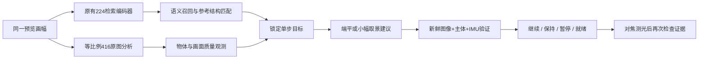

# 摄影规则与执行效果验证 · 2026-10-16

本轮交付重点是检测输入、场景适用规则和执行反馈。新的相对取景评分头完成真实训练和一次验收，但未达到准入条件，正式 App 保持关闭。不能据此宣称模型已经学会判断人类认为更美的照片。

## 实际运行链路



MobileNetV3-Small 512 维检索模型、406 条检索向量、53 张历史测试和原人像质量头验收均保持原样。新检测从同一旋转、镜像和裁剪后的预览取样，等比例缩放到长边 416，再填边；不再把已压缩的 224 正方形放大给物体模型。检测框逆变换回真实预览坐标。缺少原图输入时清除旧检测，不能静默混用旧预处理。

## 摄影规则如何辅助

| 情况 | 可以使用的证据与规则 | 边界 |
|---|---|---|
| 单人像 | 已测人脸边距、局部清晰度、亮部变化、真实 IMU、参考脸部位置 | 人脸框不能保护未检测的头发、四肢；不凭脸框裁整个人 |
| 食物、单件静物 | 支持类别的完整主体框、边缘安全空间、清晰度与亮部变化；背景干扰只作场景条件下的软提示 | 一块点心不能代表整盘食物，复杂组合应拒绝单主体动作 |
| 自然风景、城市 | 参考布局、真实 IMU，保持已有居中与对称的可能性 | 更多树叶、山石、建筑线条不等于变差；明暗边界不能冒充地平线 |
| 植物、未知主体 | 保留参考与已有可靠端平能力，缺失结构保持未知 | 花瓶框不是花束轮廓，不据此裁花叶 |

三分法、居中和留白只是候选方案。候选包含当前画面，最多两个小幅真实裁剪；不把裁剪的偏好解释成平移后会出现什么背景。候选偏好支路只有模型通过验收才启用，本次保持关闭。主体保护、质量退化检查和单步反馈持续运行。

## 执行反馈

- 图像、主体和 IMU 分别携带真实采样时间及观测 ID。新画面出现主体清晰度下降、亮部损失或边距退化，即使检测框仍在缓存，也能撤销就绪。
- 正面确认仍需新的主体及 IMU 证据，三个独立确认跨越至少 750ms。重复显示的缓存不累计完成次数。
- 比较锁定目标期间的几何误差和可测质量。背景像素平移仅帮助排除主体自行移动，不宣称测得三维机位。
- 自动曝光变化、场景/尺度变化以及无法归因的主体移动先暂停归因，再等待稳定的新证据；不能把这些变化报告为用户执行成功。
- 单纯曝光变化保留原动作的技术质量基准。曝光稳定后若仍然过曝或模糊，不能把坏画面重设为合格基准；瞬态变化恢复后可以重新验证。
- 清晰度、主体亮部等相对恶化会暂停。背景边缘增加不单独证明画面更差，尤其不能否决风景纹理或城市线条。
- 自动快门在 AF/AE 等待结束后复查最新就绪状态与证据时效；对焦等待可取消、可超时。用户主动按当前画面拍照的入口保留。

这里的“就绪”代表观测到的构图与质量条件满足，不是人类审美保证。

## 检测与素材结果

全量 406 张参考重新测量。新输入得到 7 张自动静物候选；逐张查看原图与框后，3 张因错误类别或不完整食物组合隔离，4 张保留为参考动作候选。新审核绑定图片、模型、预处理及整份检测结果的 hash，不能沿用旧框的审核。

固定 57 张/57 来源簇的新旧对照：

| 指标 | 原224放大输入 | 新原画幅输入 |
|---|---:|---:|
| 有高置信检测的图 | 30 | 28 |
| 高置信框全部能镜像匹配的图 | 18 | 18 |
| 通过自动静物动作初筛的图 | 15 | 4 |

这些是覆盖与一致性诊断，不是 mAP，也不是美感提升率。新输入并没有让所有照片的检测更准，部分错误消失、部分图片出现更多歧义，因此保留拒绝机制。4 张复核参考作为实时输入重放时，只有 1 张通过额外的低置信竞争主体检查；这不是新照片检索覆盖率。4 张参考中 3 张通过镜像一致性检查。16 个诊断裁剪有 6 个被主体保护拒绝，允许裁剪中测得主体截断为 0；保证仅限检测框。

Python 与 Kotlin 对 997×601 图像的实际 native 预处理比对：519,168 个数值，最大绝对差为 0。406 张桌面 CPU 分析含前后处理的 p50 为 95.7ms、p90 为 107.5ms，不能推断中端手机性能。

## 相对取景模型的真实结果

新实验复用冻结的 512 维编码器，加 93 维空间颜色/边缘/主体/场景特征，605→64→1 小头。每个裁剪独立编码。冻结 257 个来源簇，1187 个图像版本；原图及 JPEG90 版本共 2374 次本地教师推理，只接纳教师方向稳定的偏好。原图不预设为更好。

教师仍是作者发布的 [CLIP 审美预测器](https://github.com/christophschuhmann/improved-aesthetic-predictor)，其分数属于弱监督。也核查了作者的 [GAIC 裁剪项目](https://github.com/HuiZeng/Grid-Anchor-based-Image-Cropping-Pytorch)：代码许可与外部数据、权重的使用条件分别记录，未将尚未核实的数据/权重纳入部署。

三个预先固定的 weight decay 候选仅在验证集选择，最终验收执行一次：

| 指标 | 结果 |
|---|---:|
| 有稳定裁剪偏好的验收来源簇 | 20，低于要求30 |
| 稳定裁剪偏好对 | 30 |
| 按来源簇宏平均的教师排序一致率 | 47.5%，低于要求70% |
| 簇级 bootstrap 95%下限 | 27.5%，低于随机水平 |
| 简单摄影规则基线 | 42.5% |
| 始终保持当前构图基线 | 60.0% |
| 非弃权覆盖率 | 96.67%，高覆盖未带来可靠排序 |
| 试验头 JSON / float32 参数 | 238,991 / 155,396 bytes |
| 正式部署 | disabled，无新增权重 |

只有风景有 12 个有效验收簇，食物/生活静物各 3、人像 2；不满足分场景启用条件。编码器可能见过部分源图，这不是全系统全新独立测试。教师一致率不是用户喜欢概率。

独立审查还发现 V1 实验的 PIL 缩放与 Android 像素路径不同，当前帧 embedding 的路径也不一致。该问题作为独立部署否决记录；原验收和权重没有被重写或重跑。后续的 canonical V2 预处理与数值验证独立保存，不能倒过来证明 V1 已对齐。下一轮训练须重新冻结协议并使用未消耗的验收来源。

V2 进一步暴露了 Float/Double 插值中间精度导致的边界一像素差异。修正手机实现后，四组横/竖画幅的当前图与真实裁剪，其原生 RGB、224 RGB 和 NCHW 张量 hash 全部一致，共比对 602,112 个张量数值；93 维空间特征最大绝对差为 2.69×10⁻⁷。原检测输入的 519,168 数值比对也保持完全一致。

## 文件与复现入口

所有原始图片、模型环境、教师、缓存、试验权重和大文件均留在原 `AI-camera` 内。仓库只保存代码、正式部署配置/参考结构及去除本地路径的证据。

| 内容 | 项目内位置 |
|---|---|
| 本轮唯一实验根目录 | `local-output/framing-preference-2026-10-16/` |
| 旧/新输入与镜像对照 | `native-input/comparisons.html`、`native-input/summary.json` |
| 406张原图/结构对照 | `references-native-reviewed/comparisons.html` |
| 冻结协议、一次验收、部署审查、失败权重 | `preference/` |
| 日志与检查结果 | `validation/`、`android-validation/` |
| 新输入评估 | `ai/tools/evaluate_native_detector_input.py` |
| 参考重建与打包 | `build_multiscene_references.py`、`package_multiscene_recommendation.py` |
| V1失败实验复现 | `ai/tools/build_template_db/run_framing_preference.py` |
| 偏好分支准入与打包 | `validate_framing_preference_assets.py`、`package_framing_preference.py` |

参考重建默认使用 native V2，支持 `--object-review` 和仅同预处理兼容的 `--reuse-sidecar`。首次诊断输出未经审核，不能通过发布门禁。新实验输出目录必须为空；已有验收只允许 `--reuse-completed` 核验后复用，不能反复验收调门槛。

公开证据：[输入与参考评估](evidence/native-detector-evaluation-2026-10-16.json)、[新检测视觉复核](evidence/multiscene-object-review-2026-10-16.jsonl)、[训练、选择与验收](evidence/framing-preference-evaluation-2026-10-16.json)。

标准库资产检查入口：

```sh
python -B ai/tools/validate_android_v9_assets.py --asset-root aicamera-app/app/src/main/assets/ai/v9
```

真实设备上的连续推荐效果、发热和延迟没有验证；也没有把几何模拟、弱监督教师或桌面测试包装为人类实拍审美改善。

本地最终回归：Python 381 项（1 项可选 USearch 环境相关测试跳过），包含相机等待取消测试的 Kotlin/JVM harness 307 项通过，打包资产门禁通过。JVM harness 使用 Android/ONNX 等替身，不代表真机测试；完整 Android 依赖编译和原生引擎由本分支 GitHub CI 检查。冻结资产差异见 [基线核对](evidence/framing-frozen-baseline-2026-10-16.json)。
